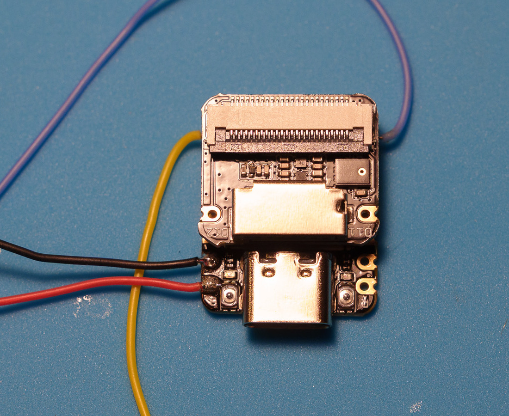
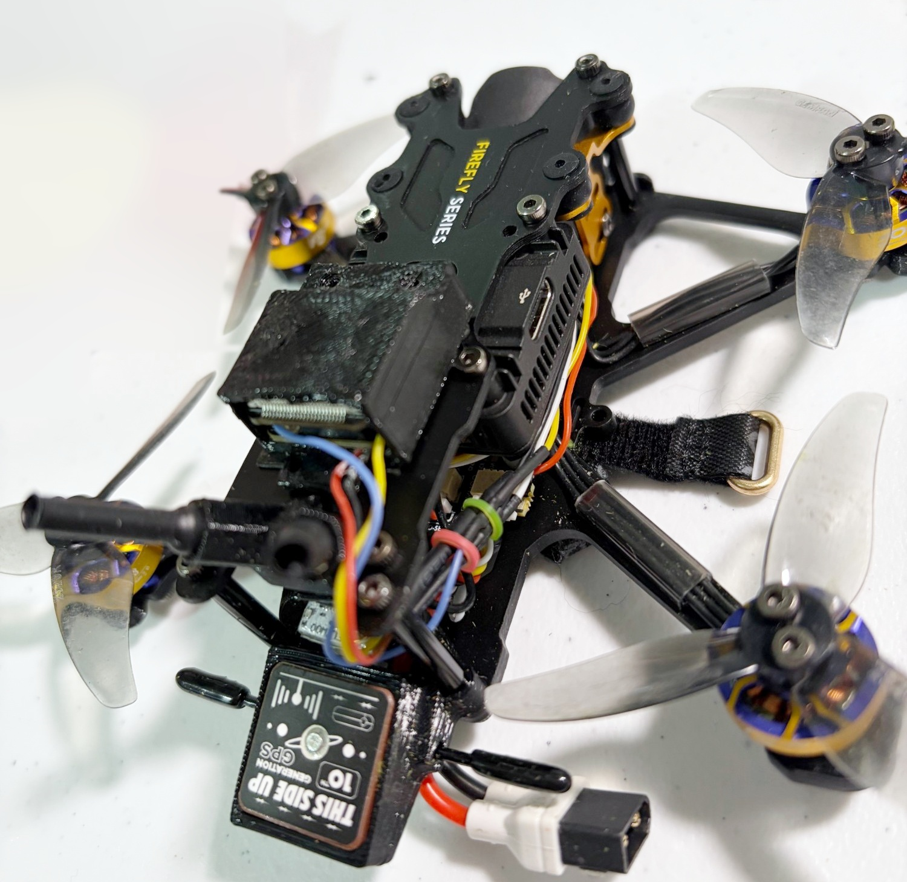

# FPV Audio Recorder

Onboard FPV audio without carrying an extra GoPro or other action camera. This DIY project is a tiny, battery-free audio recorder for a quadcopter. The build uses a Seeed Studio XIAO ESP32S3 Sense with its microphone board, powered from the flight controller. The firmware starts a recording when the quad arms and closes it when the quad disarms.

**Project status: core build and real-flight milestone complete (2026-10-22).** The SD-free [firmware v2](firmware/v2/README.md) flew in the [V7 one-piece TPU case](hardware/recorder-holder/README.md) and retained a 110.18-second onboard recording with zero missing encoded frames. Recording followed Betaflight arm/disarm and used the flight controller’s clock. See the [flight-test report](docs/flight-test-2026-10-22.md) and [flight video with onboard audio](https://rsmith4321.github.io/fpv-audio-recorder/#flight-test).

**Known issues:** USB sometimes needs a recorder reset before the drive appears. Easy Eject does not yet support v2, and the firmware and case downloads remain **pre-releases**. The [field report](docs/flight-test-2026-10-22.md#remaining-work) describes the post-flight USB candidate and remaining validation.

The public progress page is at <https://rsmith4321.github.io/fpv-audio-recorder/>.

Follow the [photographed prototype build](docs/build.md) for camera removal, the four recorder wires, and the diode connection. For the Flywoo build, see the [connector installation guide](docs/flywoo-goku-f405-se.md): no soldering onto the flight controller, using its UART1 socket and supplied harness.

## What has been verified

Firmware v2 in the V7 case (real-flight test, 2026-10-22):

- Two readable 16 kHz mono WAVs, 110.18 s and 2.82 s, with durations matching `FLIGHTS.CSV`.
- Both recording entries report `DISARM`, the flight controller's clock and no overwritten start. Separately fetched raw Opus streams have zero missing encoded frames.
- The longer recording contains sustained, changing motor/propeller sound; the case was flown with the recorder installed. See the [field report](docs/flight-test-2026-10-22.md) for audio measurements and test limits.

Firmware v2 (bench, 2026-10-18, USB power):

- The recorder mounts in macOS as the read-only `FPVAUDIO` drive, and recordings from the earlier firmware survived the update.
- Audio copied from the drive matches the serial download; copying runs at 9–10× real time.
- A bench-clock recording got the right timestamped name and matching times in `FLIGHTS.CSV` and the WAV's time reference, with 0 lost frames. Chip temperature stayed near 40°C without airflow, well below the SD firmware's 50–68°C.
- The B-button format erased everything without a restart.

Earlier microSD firmware (v0.1.0, then a −12 dB gain build that wasn't published separately):

- Recorded on Betaflight arm/disarm from the flight controller's 4.5 V socket through the diode (October 10), then 16 outdoor flight recordings on October 13 with every file closed cleanly.

## Using it

1. Fly: the recorder reads armed state from Betaflight over a spare UART (read-only) and records while armed. It never sends flight commands.
2. Plug the recorder into a computer with a USB-C data cable and copy the WAVs off the `FPVAUDIO` drive.
3. Optionally run `audio_video_sync.py` to line the audio up with DJI O4 Pro clips.

Provide airflow whenever the powered quad is stationary, including USB setup.

## Mounting note

The microphone opening is on the exposed face of the Sense board. The four wires are soldered to the inward face of the main XIAO's plated edge pads, with low-profile joints protected inside the gap and wires exiting sideways. Check that the board connector seats fully and no solder touches components on the Sense board. In the V7 case the stack slides in from the open back and the wires leave through it; secure the harness to the frame, and keep glue well away from the microphone.

## Firmware v2: the recorder as a USB drive

[Firmware v2](firmware/v2/README.md) (pre-release, flown 2026-10-22):

- Plug the recorder into a computer and it appears as a read-only USB drive, `FPVAUDIO`, with **one WAV per flight**, `FLIGHTS.CSV` and a `README.TXT`.
- Files are named by the flight controller's clock, e.g. `FPV_20261018173825_P0005_F01.WAV`, and carry a Broadcast WAV time reference so editors can place them by time of day.
- About 30 minutes fit in the internal flash; the **oldest audio is overwritten** when it's full.
- **Format:** hold the button marked **B** for about 10 seconds while steadying the plug; the LED blinks, blinks faster, then gives **three long flashes** when everything is erased.
- Host tools download over USB serial and line the audio up with DJI O4 Pro clips.

## 3D-printed case

The [V7 one-piece TPU sleeve](hardware/recorder-holder/README.md) (23.76 × 20.68 × 11.18 mm, 2.15 g) holds the SD-free recorder, which slides in from the back with no lid or glue. It has a mic grille and B/R button holes. Print it standing, USB face down, as saved, and dry the TPU first. **Flown with firmware v2 on 2026-10-22.** The previous [V6.5 two-piece case](hardware/recorder-holder/v6.5/README.md) remains for microSD builds. Alternative designs and improvements are welcome through pull requests or issues.

## Remaining follow-up

- Finish USB startup/reconnect validation and Easy Eject v2 integration before promoting the firmware release or update manifest.
- Continue evaluating wind protection, repeated-flight case retention and operating temperature. Details are in the [field report](docs/flight-test-2026-10-22.md#remaining-work).

## Scope of this repository

This public repository holds the project page, the case designs, and the versioned firmware source and images. The flight-test video is a deliberately selected public sample. Private recordings, bench audio, raw flash backups, personal device identifiers, and unrelated local build artifacts are excluded.

## Related work

[FPVSoundLogger](https://github.com/SebGalina/FPVSoundLogger) is another open-source approach to onboard FPV audio recording. This project explores a XIAO Sense with its integrated microphone, recording to internal flash and appearing as a USB drive.
