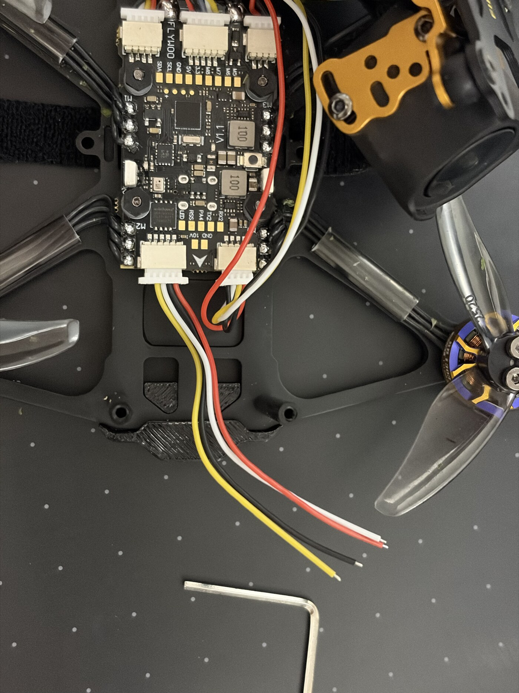
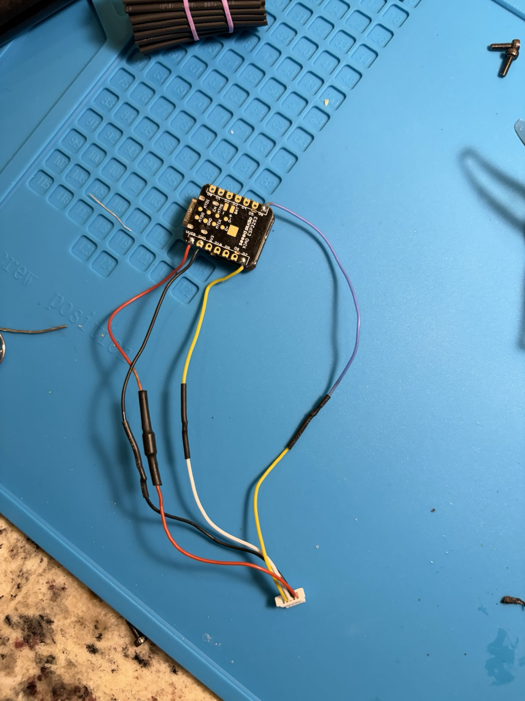
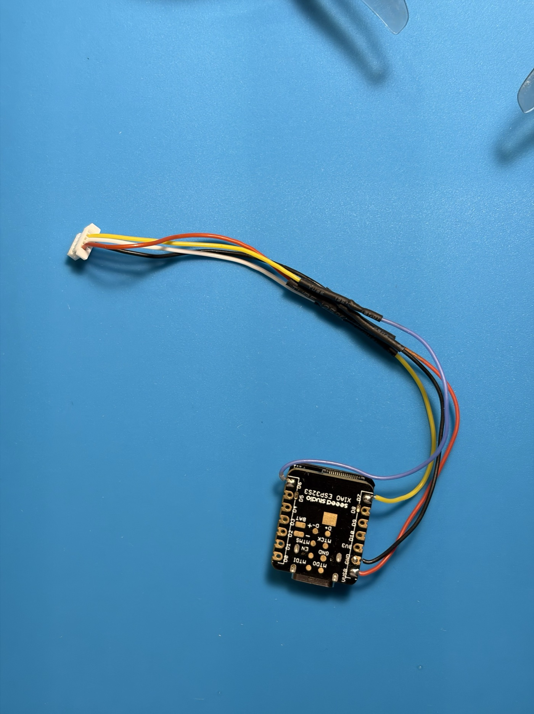
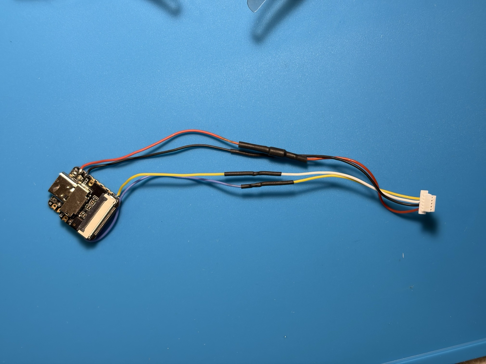
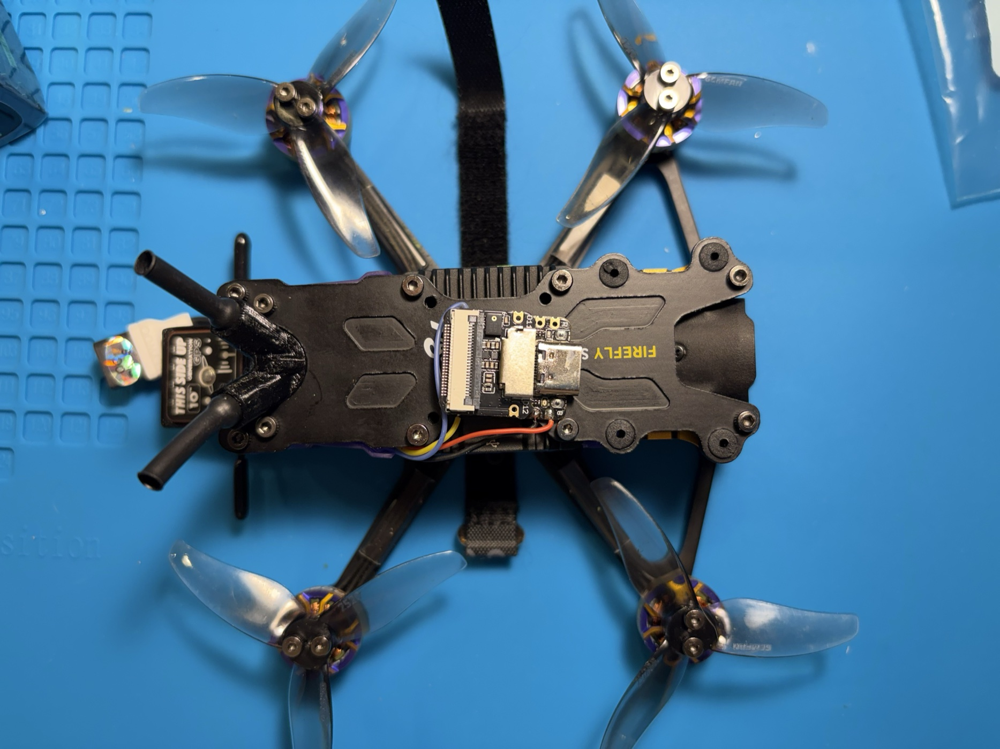
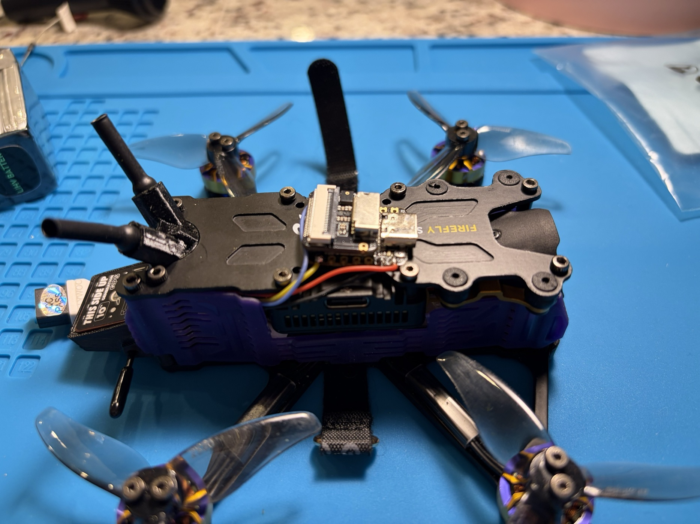
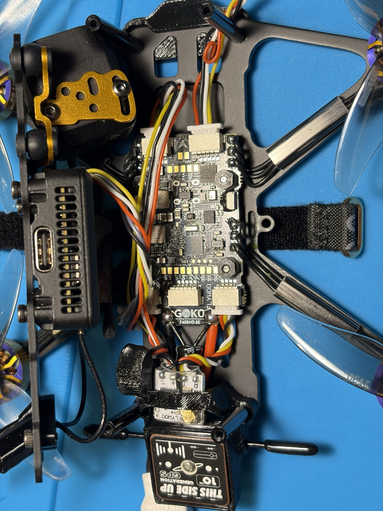
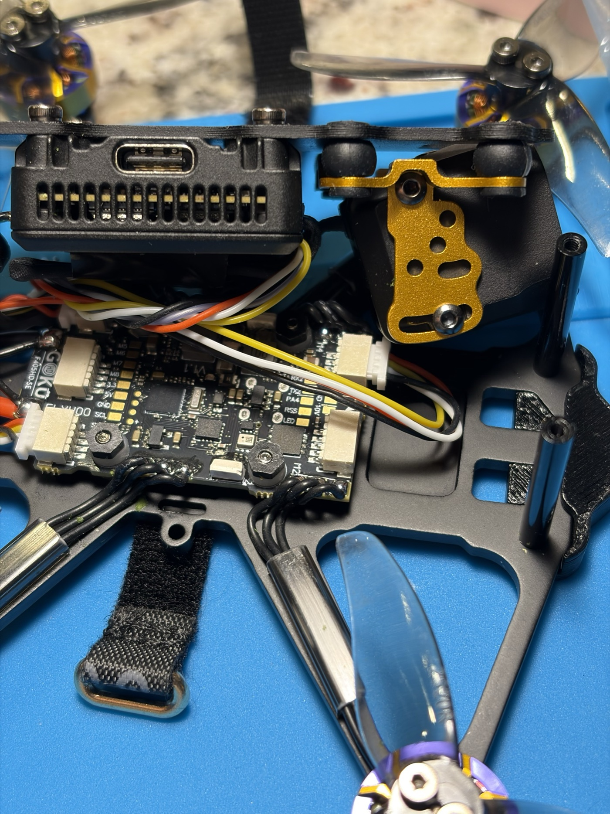
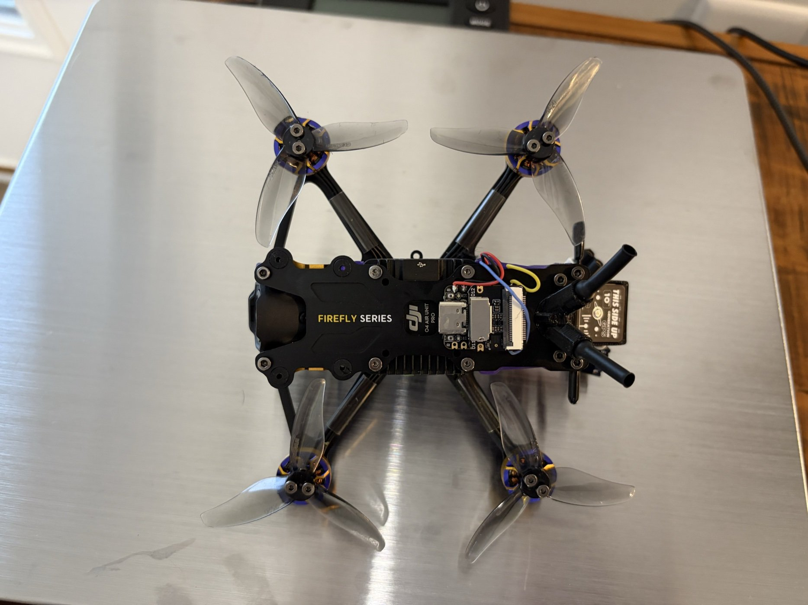
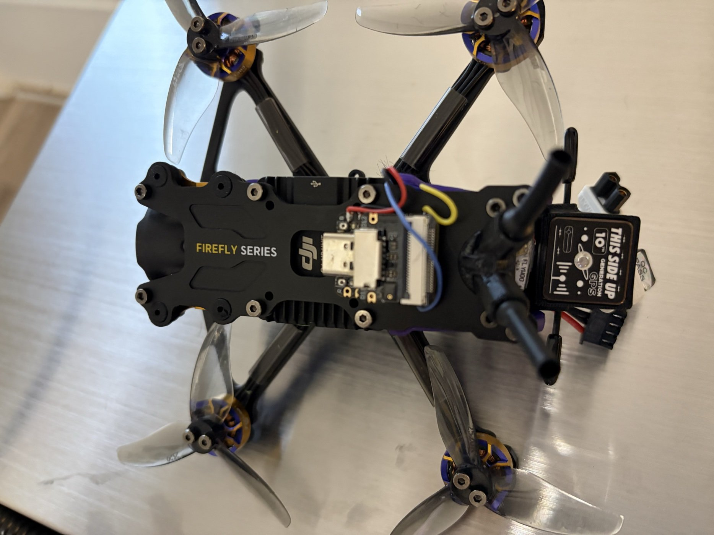

# Flywoo GOKU F405 SE: recorder connector installation

**Installed and flight-tested — updated October 22, 2026.** The recorder uses the flight controller's UART1 socket, supplied harness and an inline diode, avoiding soldering onto the flight controller. The SD-free [firmware v2](../firmware/v2/README.md) flew in the [V7 printed case](../hardware/recorder-holder/v7/README.md) and retained a 110.18-second recording with zero missing encoded frames. See the [flight-test report](flight-test-2026-10-22.md).

## Prototype hardware and historical port allocation

The prototype quad uses a **Flywoo GOKU F405 SE 3–4S 20A AIO**, board marking V1.1, with a BMI270 gyro. It identified as `FLWO/FLYWOOF405S_AIO`, running Betaflight **2025.12.2**. This table records the **October 7 prototype setup**, before the recorder was configured; it is not a current port map or a template for another quad.

| Port | Historical configuration, October 7, 2026 |
| --- | --- |
| UART1 | Unassigned; selected for the recorder |
| UART3 | Serial receiver (ELRS) |
| UART4 | GPS |
| UART6 | MSP and VTX (MSP + DisplayPort), used by DJI O4 |

UART1 was subsequently enabled for recorder MSP at 115200 baud. Check your own controller's current port allocation and physical pinout before choosing a free UART; preserve its receiver, GPS and video configuration.

## Socket and cable

References: [Flywoo SE manual](https://flywoo.net/pages/goku-2-4s-se-20a-aio) and [full-size official connector diagram](https://img-va.myshopline.com/image/store/1673593876355/73502be504824d0fb2e820800d34d2b9.webp?h=1755&w=2482). The manual page title says 2–4S, while the supplied card and product listing say 3–4S; match the SE board layout and revision rather than using the different square F405 HD AIO diagram.

The UART1 socket is the **upper-right five-position socket in the official diagram**, labeled `4.5V / GND / TX1 / RX1 / SBUS(1)`. It is the **bottom-left socket in the photograph below**, because the board is rotated 180 degrees relative to that diagram.

Use the supplied **five-position plug with four populated wires and free tinned ends**. The unused position is SBUS(1). Count housing positions, not just wires. A four-position housing is not the same connector; do not force it into this socket.

The photograph and manufacturer diagram establish the visual mapping for this specific harness. They do not constitute a multimeter continuity or voltage measurement. Other cable colors and connector pin arrangements may differ.

## Harness wire connections

Disconnect the quad battery and both USB connections before assembling the wiring. For the pictured harness and the recorder wire colors used in this prototype:

| Flywoo harness wire | UART1 pin | Recorder connection |
| --- | --- | --- |
| Red | 4.5V | Through one 1N5817 Schottky diode to red XIAO VBUS wire |
| Black | GND | Black XIAO GND wire |
| White | TX1 | Yellow XIAO D7 / RX / GPIO44 wire |
| Yellow | RX1 | Purple XIAO D6 / TX / GPIO43 wire |
| Empty position | SBUS(1) | Unused |

TX and RX are crossed. Use the ordinary RX1 connection, **not SBUS(1)**. Confirm pin-to-wire continuity on the unpowered harness before connecting the recorder.

Fit the diode in the power wire: **unstriped anode toward the Flywoo; striped cathode toward XIAO VBUS**. Insulate each splice and the diode with heat shrink. The diode blocks USB power from feeding backward into the flight-controller supply. Do not connect recorder VBUS to the board's 10V or BAT connections.

This cable connects directly to the recorder's existing wires; no flight-controller pad soldering is needed. Trim and secure the harness so it cannot reach the propellers or pull on the socket.

## Power and setup

The socket is labeled **4.5V**; the diode reduces the voltage reaching XIAO VBUS. This connection powered arm/disarm recording with the recorder's USB unplugged on October 10, followed by outdoor recordings and the October 22 v2/V7 flight. These recording results establish operation on this build, but no supply or VBUS voltage-under-load measurement is documented.

For a new installation, inspect the diode polarity and insulation, check the unpowered harness for shorts and continuity, and measure the supply and VBUS under load. Back up Betaflight settings before enabling MSP at 115200 on the chosen UART. With props removed and airflow provided, verify recorder startup and arm/disarm file finalization using quad power with recorder USB disconnected. USB power can conceal an inadequate external supply. Preserve arming protections and confirm the saved configuration after reboot.

The published firmware can intermittently need a reset before USB appears. A later local startup candidate was installed after the flight and remains under validation; see the [field report](flight-test-2026-10-22.md#remaining-work).

## Harness assembled — October 10, 2026

The four splices and the inline diode are soldered and covered with heat shrink. The splices are staggered along the cable so no two joints sit side by side. Red goes to red through the diode, black goes to black, Flywoo white (TX1) goes to the recorder's yellow (D7/RX), and Flywoo yellow (RX1) goes to the recorder's purple (D6/TX). The diode sits inside the larger section of tubing on the red lead. The builder confirmed its striped cathode faces the recorder.

At this assembly stage, no multimeter continuity, short or voltage checks were recorded. The pin assignment came from Flywoo’s diagram and the plug photograph; subsequent recording tests do not replace those electrical measurements.

## Historical trial mount — October 10, 2026

These early photographs show the recorder with its Sense board attached, held to the quad’s carbon top plate behind the camera by a small piece of 3M tape. USB-C, the microSD card and the microphone stay exposed. The harness runs down the side of the frame to the UART1 socket. This temporary bare-board mount was later replaced by the V7 printed sleeve.

Carbon fiber conducts electricity, so the tape must keep every pad and solder joint on the underside and edges of the XIAO off the plate. Secure the harness so it cannot be pinched between plates or standoffs, rub on screw heads, or reach the propellers.

## Historical VHB mount and first armed tests — October 10, 2026

The next early mount used 3M VHB behind the DJI O4 Air Unit Pro, with the USB-C port, microSD card and microphone facing up. The VHB is foam and does not conduct, so it also keeps the XIAO's underside off the carbon. The recorder firmware leaves Wi-Fi and Bluetooth off, so the only thing near the O4 antennas and the GPS is the small board itself.

UART1 was set to MSP at 115200 in Betaflight. With recorder USB unplugged and power coming from the 4.5 V socket through the diode, arming started recording and disarming closed a playable WAV. This covered props-off testing and three short indoor hand-held hovers with the earlier microSD firmware. Early audio-level experiments led to DC blocking and reduced digital gain; these are historical tests, separate from the current internal-flash build.

## Current mount: V7 sleeve

The [one-piece V7 TPU case](../hardware/recorder-holder/v7/README.md) replaces the bare-board mount above. The recorder slides in from the open back, its harness exits through that opening, and the case's flat underside takes mounting tape. Secure the harness to the frame and keep the microphone grille clear.

Firmware v2 and this case were flown on October 22. Arm/disarm endings and flight-controller timestamps were retained in the recordings. Repeated-flight retention, measured vibration, wind protection and in-flight temperature remain separate validation work; see the [field-test report](flight-test-2026-10-22.md).
