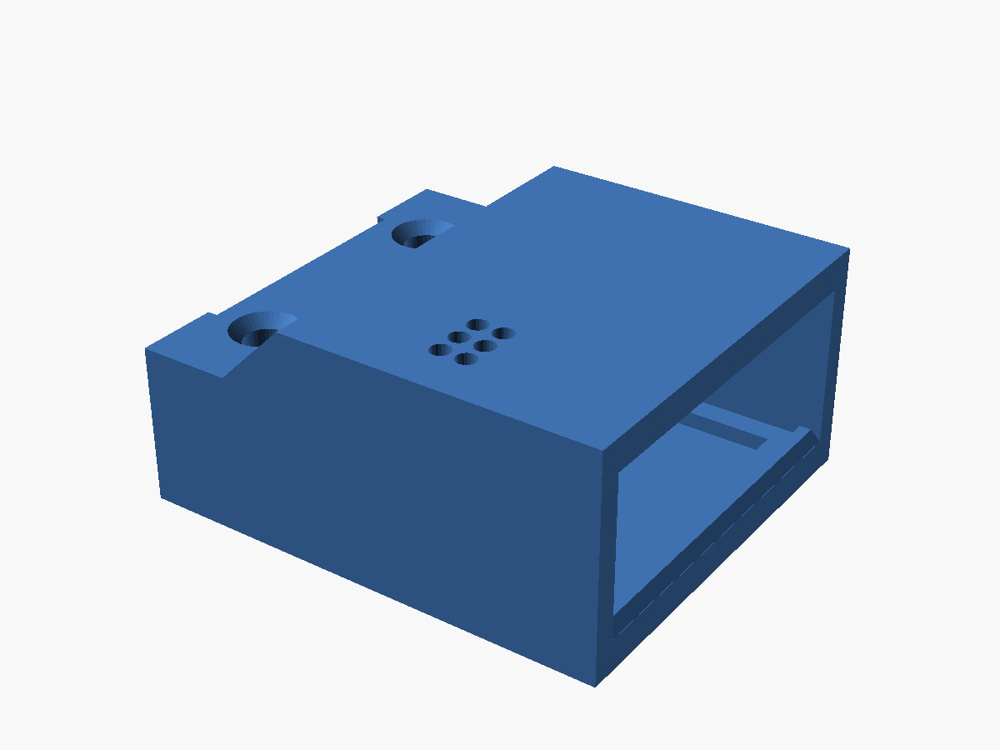

# Recorder case and original holder

## Current case: V7 sleeve (pre-release)

The [V7 one-piece TPU sleeve](v7/README.md) is for the SD-free recorder running [firmware v2](../../firmware/v2/README.md). The board stack slides in from the open back and clicks over a small floor detent; there's no lid and no glue. The roof has a mic grille and B/R button holes, the USB window fits the receptacle, and the flat underside takes mounting tape. 23.76 × 20.68 × 11.18 mm, 2.15 g in TPU.

**Flown with firmware v2 on 2026-10-22.** This printed sleeve carried the recorder during the [real-flight test](../../docs/flight-test-2026-10-22.md). Repeated-flight retention, vibration, wind-noise protection and in-flight temperature remain unmeasured; the download remains a pre-release.

- [Sleeve STL](v7/recorder-case-v7-sleeve.stl) and [3MF](v7/recorder-case-v7-sleeve.3mf) (print standing, USB face down, as saved)
- [Socket-removed variant STL](v7/recorder-case-v7-sleeve-socket-removed.stl)
- [Editable OpenSCAD source](v7/recorder-case-v7.scad)
- [Dimensions and verification](v7/SPECIFICATIONS.md)
- [Printing, assembly and design contributions](v7/README.md)

I'm new to 3D printing, so there's probably a better way to design this case. If you come up with a different or improved design, please submit a pull request! You can also open an issue with ideas, photos, or printable files.

## Previous case: V6.5 (microSD)

The [V6.5 two-piece TPU case](v6.5/README.md) has a flush lid with an internal locating lip, accessible USB/microSD openings, a rear wire exit, and a flat underside for mounting tape. Use it if your recorder still uses the microSD card with the v0.1.0 firmware. The builder approved the V6.4 printed fit apart from tight port access; V6.5 widens those openings by 0.6 mm overall each, and those final widened openings were not reprinted.

- [Bottom STL](v6.5/recorder-case-v6.5-bottom-flat.stl) · [Lid STL](v6.5/recorder-case-v6.5-lid.stl) · [OpenSCAD source](v6.5/recorder-case-v6.5.scad) · [Dimensions](v6.5/SPECIFICATIONS.md)

## Original open holder

The earlier `recorder-holder.scad`, `recorder-holder-v2.stl`, and `render-holder*.png` files are retained for reference. They describe the original open tray with underside rails, not the current case. See the repository history for the original holder documentation.
