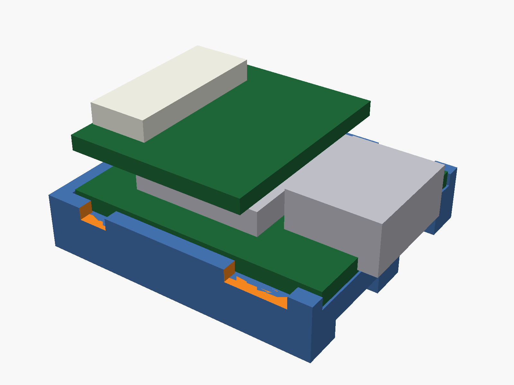
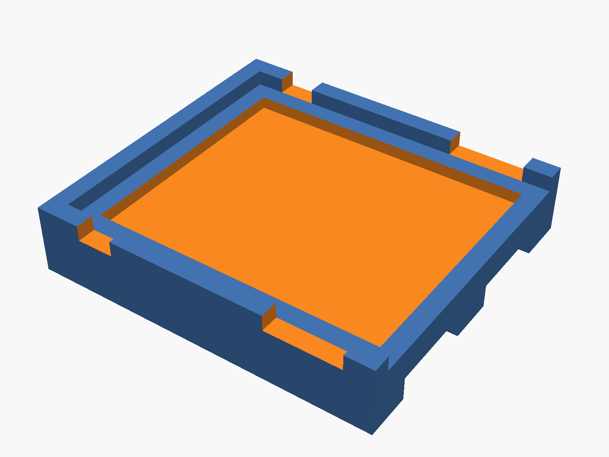

# Recorder holder (3D print)

**Status: designed, not yet printed or test-fitted.** The dimensions come from Seeed's official 3D model of the XIAO ESP32S3 Sense, so it should fit. Testing is coming soon, and this page will be updated with the results.

## What it does

A shallow tray that holds the XIAO by the edges of its bottom board, leaving the top fully open:

- **The top stays open.** The microSD card, the microphone and the USB-C port remain uncovered.
- **The USB-C end has no wall**, so a cable plugs straight in.
- **The walls stop 0.25 mm below the main board's top surface**, so they never touch the harness wires, which leave from the gap between the two boards. Notches at the 5V/GND and D6/D7 pads give extra room for solder.
- **A shallow recess under the board** takes a square of VHB (1.0–1.1 mm VHB compresses into the 0.8 mm recess).
- **Three rails underneath** take VHB strips and leave a 1.5 mm air gap above the mounting surface. On the prototype quad that surface is the DJI O4 Air Unit Pro's metal top, which gets hot.

The overall size is about 22.5 × 20.5 × 4.5 mm.

## Board measurements used

From Seeed's [XIAO ESP32S3 Sense 3D model](https://wiki.seeedstudio.com/xiao_esp32s3_getting_started/) (Resources section):

| Part | Size |
|---|---|
| XIAO main board | 20.96 × 17.78 mm, 1.25 mm thick, flat underside |
| Sense expansion board | 14.7 × 16.8 mm, 2.9 mm above the main board; it does not cover the USB-C end |
| USB-C connector | overhangs the main board's end by 1.5 mm |

Seeed's model files are not redistributed here; download them from Seeed.

## Printing

- **Material:** PETG or TPU. Avoid PLA if it mounts on a video transmitter or anything else that gets hot.
- **Orientation:** rails down on the build plate, with no supports.
- **Settings:** 0.2 mm layers and 100% infill for a part this small.
- Developed for a Bambu Lab P1S, but any FDM printer should work.

## Adjusting the fit

`recorder-holder.scad` is an [OpenSCAD](https://openscad.org) file, and every dimension is a named value at the top. The most likely changes are:

- `clearance` (0.15 mm per side): raise it to 0.25 if the board will not drop in.
- `wall_below_top`: raise it if a wall touches a wire.
- `tape_recess`: match it to your VHB thickness.

Export a new STL with **F6**, then **File → Export → STL**.
