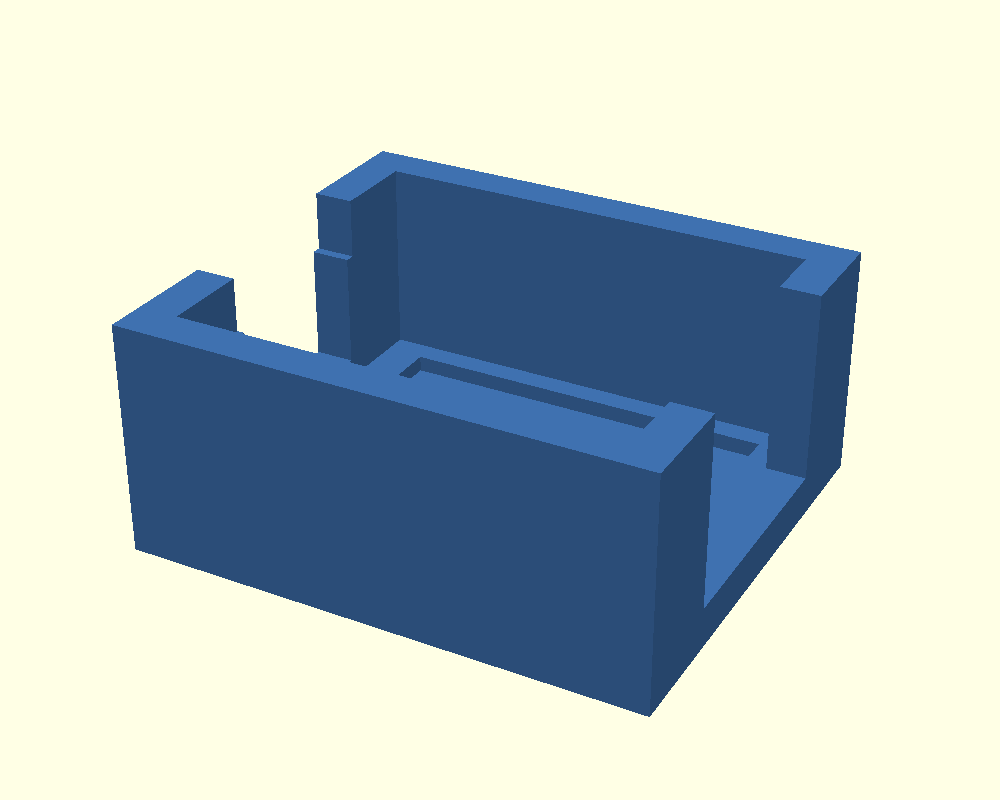
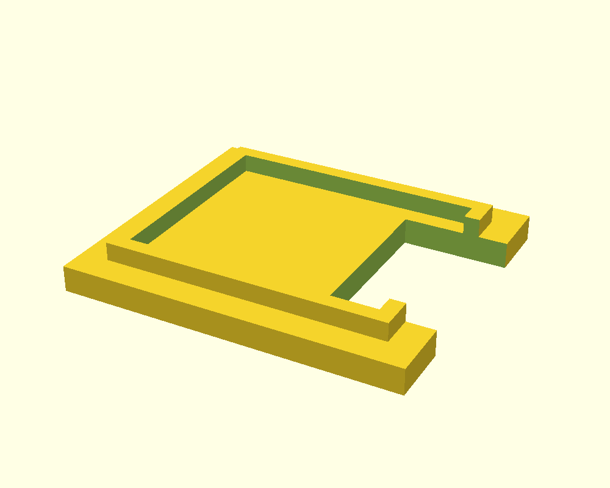

# TPU case for the FPV audio recorder — V6.5

A two-piece case for the camera-free Seeed Studio XIAO ESP32S3 Sense audio recorder. The bottom holds the board stack and has a flat underside for tape mounting to a quad. The flush lid uses a small internal locating lip and leaves an opening for the microSD card at the USB end. Wires exit through the opposite end of the bottom case.

**Case release V6.5:** The builder approved the printed V6.4 fit except for tight USB/microSD access and chose to trim that print. V6.5 widens both openings by 0.6 mm overall (0.3 mm per side), retaining the fitted pocket, lid outline, and flat mounting base. The final wider openings have been checked in CAD and mesh exports but have not been reprinted. This is a case-design release; it does not establish flight retention, thermal performance, wind-noise reduction, or a new firmware release.

## Help improve the design

I'm new to 3D printing, so there's probably a better way to design this case. If you come up with a different or improved design, please submit a pull request! You can also open an issue with your idea, photos, or printable files. I'd especially welcome improvements to the fit, lid attachment, mounting, and wind-noise protection while keeping the USB port and microSD card accessible.

Please include editable design files as well as printable STLs when possible, plus your material, printer settings, and any fit or flight-test results.

## Files

- [Editable OpenSCAD source](recorder-case-v6.5.scad)
- [Bottom STL](recorder-case-v6.5-bottom-flat.stl)
- [Lid STL](recorder-case-v6.5-lid.stl)
- [Detailed dimensions](SPECIFICATIONS.md)
- [Contribution notes](CONTRIBUTING.md)

## Printing and assembly

Use millimetres and import at **100% scale**. Print the bottom and lid as a matching V6.5 pair, arranged separately.

1. Print the bottom with its broad flat underside on the plate and its cavity facing up.
2. Print the lid with its flat outside roof on the plate and the locating lip facing up.
3. Verify those orientations after using auto-orient. The model was designed for these orientations.
4. Remove stringing and dry-fit the board. It should settle into the pocket without bowing the walls or being forced into place.
5. Fit the lid and check USB cable clearance, microSD insertion/removal, wire clearance, and the microphone opening before bonding.
6. The flat underside is intended for mounting tape. Mounting strength and flight retention still need physical testing.

The prototypes use SUNLU Fast TPU. The spool's supplied recommendation is 210–230°C nozzle, 50–60°C bed, and 80–120 mm/s printing speed; these are manufacturer ranges supplied by the builder, not a validated profile for this case. Printer, nozzle, cooling, volumetric flow, and filament condition affect the result. No final universal slicer profile is included yet.

The locating lip is an alignment feature, not a tested snap lock. A bonded lid is intended, but the adhesive and bond strength have not been validated. Keep glue clear of the electronics, microphone, USB connector, and card slot. Confirm access before permanently closing it.

## Version changes

- V6: shorter body and flush-outline lid with internal locating lip.
- V6.1–V6.3: progressively opened the lid at the USB/microSD end; V6.3 retained a 12.3 mm opening width and increased access depth to 8 mm.
- V6.4: added 0.4 mm of pocket width overall, widened the lid to match, and removed the three underside rails for a continuous flat tape surface.
- V6.5: widened the body USB/card opening from 11.5 to 12.1 mm and the lid SD opening from 12.3 to 12.9 mm. The SD opening remains 8 mm deep; case dimensions and fitted pocket are unchanged.

## Scope

This package contains the case design and print notes. USB mass-storage firmware remains a separate pending change; the card opening does not imply the recorder currently appears as a normal USB drive. Recorder electronics, wiring, and firmware information belong in the parent project's build documentation.
