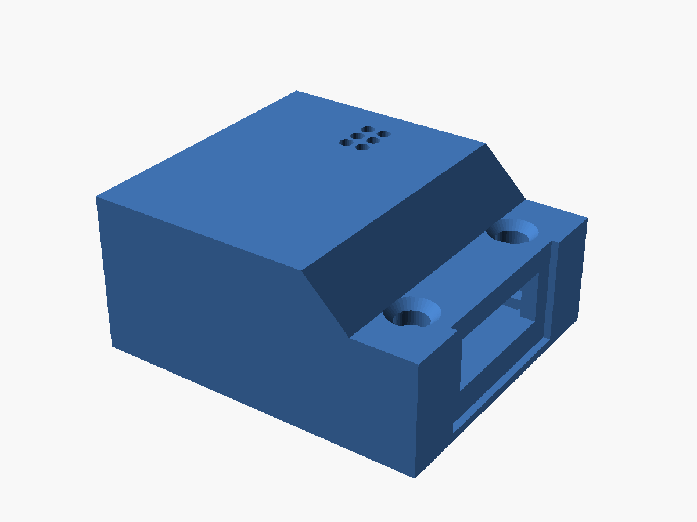
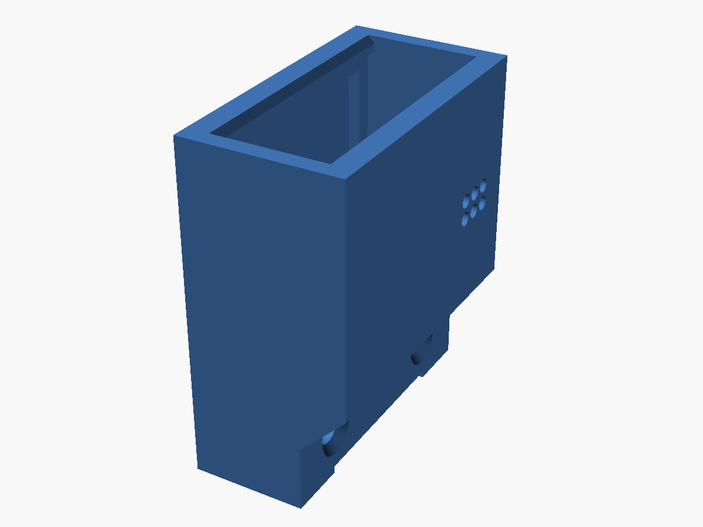
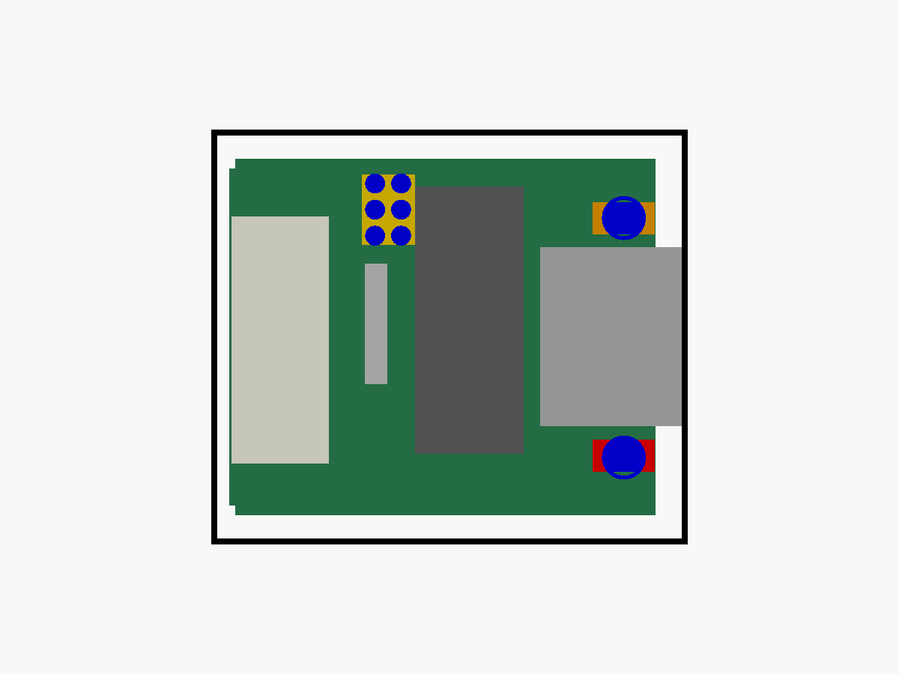
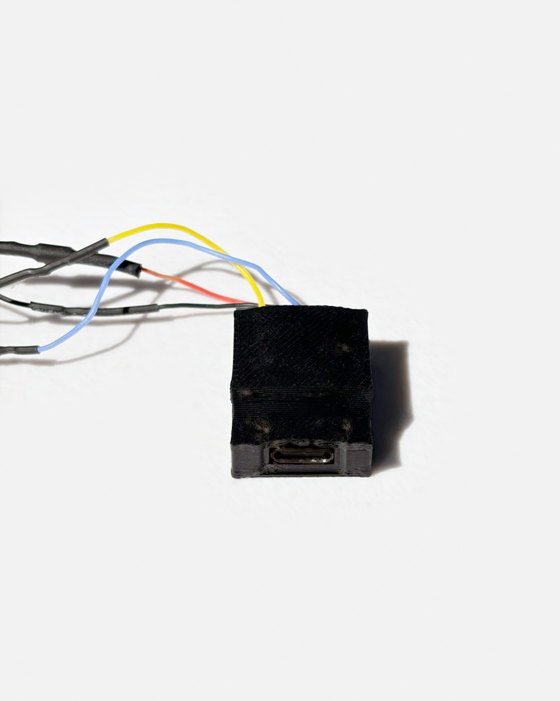
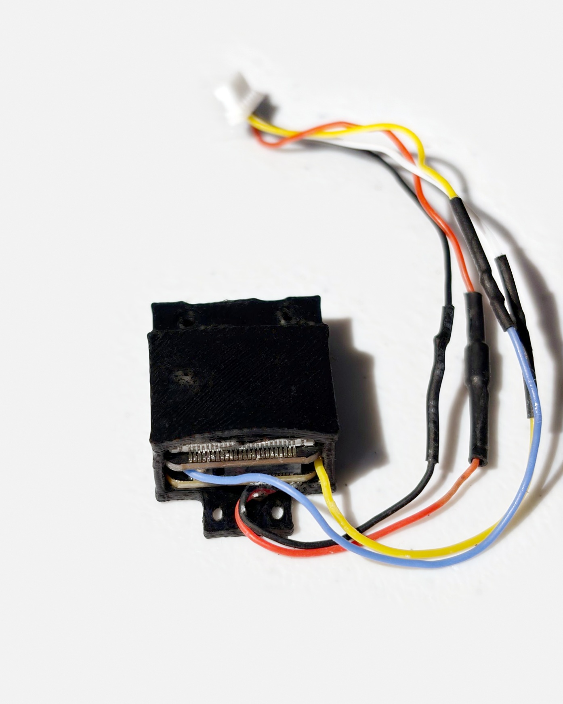
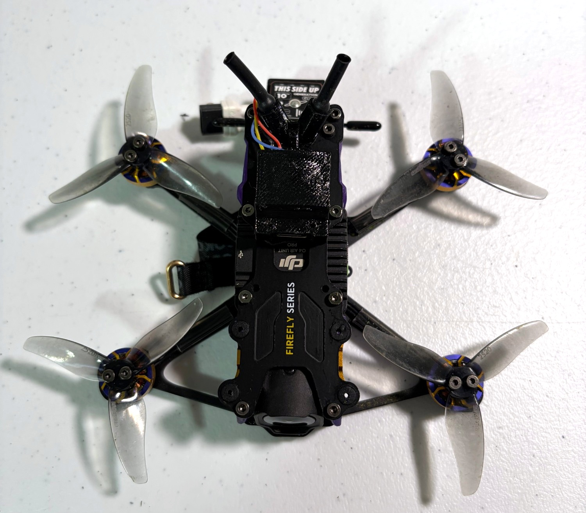
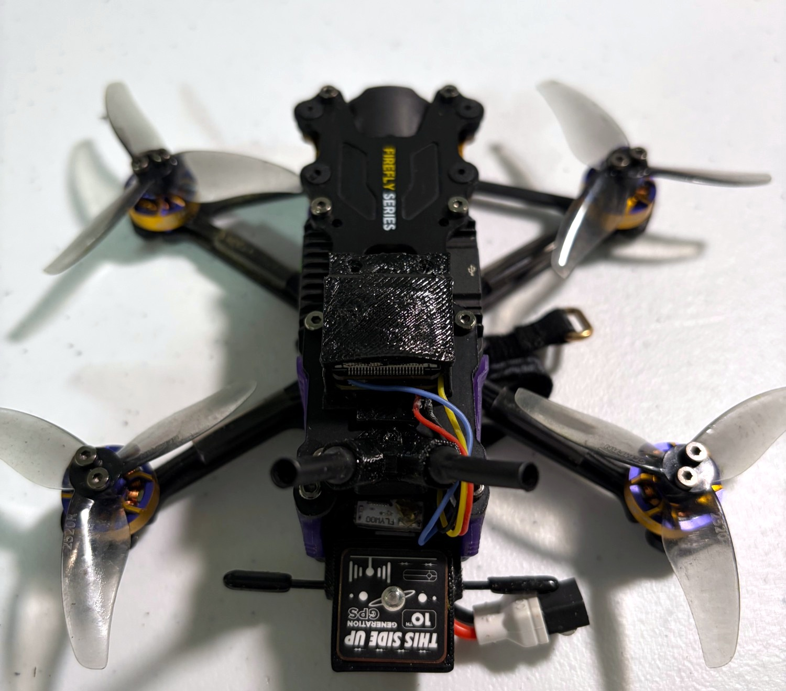
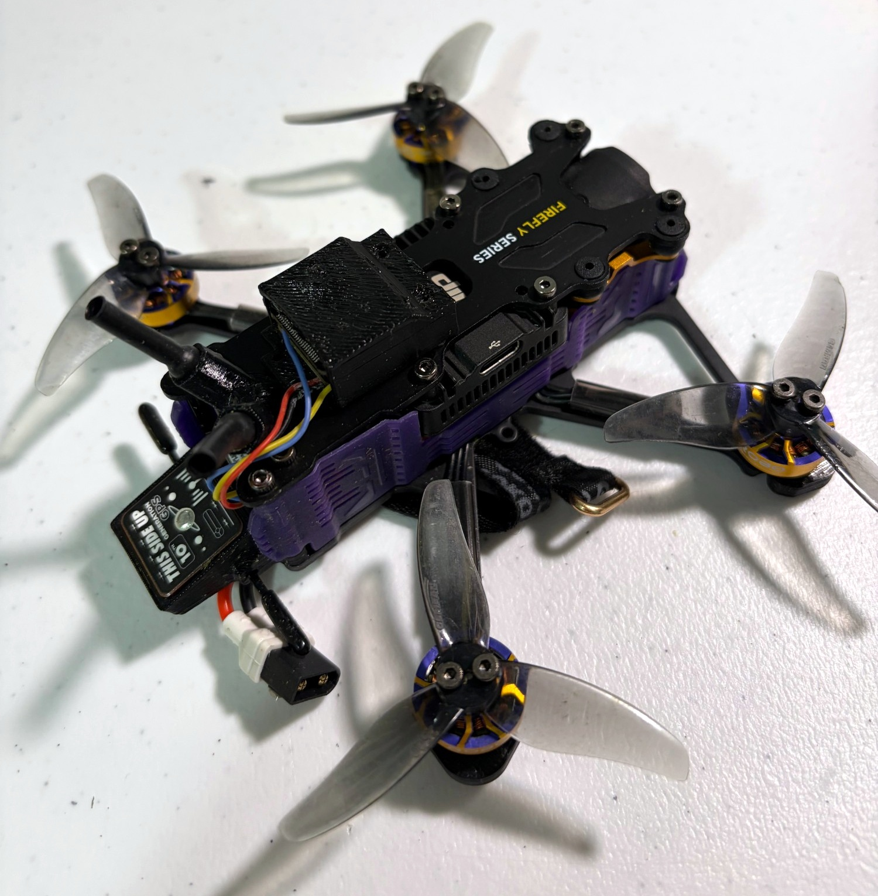

# TPU case for the FPV audio recorder: V7 sleeve

A one-piece slide-in sleeve for the camera-free Seeed Studio XIAO ESP32S3 Sense recorder running the SD-free [firmware v2](../../../firmware/v2/README.md). There is no lid and nothing to glue. The board stack slides in from the open back until the main board meets the front wall, and the USB-C port lines up with a window sized to the receptacle. A snug side fit and a small floor detent hold it. The roof has a mic grille and poke holes for the B (BOOT) and R (RESET) buttons, the wires leave through the open back, and the flat underside takes mounting tape.

**Status: bench-tested 2026-10-18; flight test pending.** The sleeve has been printed in TPU, the recorder fits snugly ("slides in nice and tight"), and it is mounted on a Flywoo Firefly 25 Mini. It has not been flown yet, so flight retention, wind noise and vibration are untested. This is a pre-release.

## Help improve the design

I'm new to 3D printing, so there's probably a better way to design this case. If you come up with a different or improved design, please submit a pull request! You can also open an issue with your idea, photos, or printable files. Fit, retention and wind-noise protection are the areas I'd most like help with.

Please include editable design files as well as printable files when possible, plus your material, printer settings, and any fit or flight-test results. See [CONTRIBUTING.md](CONTRIBUTING.md).

## Files

- [Sleeve STL](recorder-case-v7-sleeve.stl) (default, Sense board microSD socket still fitted)
- [Sleeve 3MF](recorder-case-v7-sleeve.3mf) (same part; opens standing in Bambu Studio)
- [Socket-removed STL](recorder-case-v7-sleeve-socket-removed.stl) (only if the microSD socket has been desoldered; saves about 0.04 g)
- [Editable OpenSCAD source](recorder-case-v7.scad)
- [Detailed dimensions and verification](SPECIFICATIONS.md)
- [Mesh check results](mesh-validation.json) and [checksums](SHA256SUMS.json)

| | |
|---|---|
|  |  |
| Open back with the floor detent | USB end: window and overmold recess |
|  |  |
| Print orientation, USB face down | Mic grille and B/R holes |

Printed part:

| | |
|---|---|
|  |  |
|  |  |

## Printing

- Import at **100% scale** (millimetres).
- **TPU 95A** (PETG also works), 0.2 mm layers, 4 walls, 100% infill.
- **Print it standing, USB face down on the bed, open back up.** The STLs and the 3MF are already saved this way (20.7 × 11.2 mm on the plate, 23.8 mm tall). Don't lay it flat and don't let auto-orient flip it. Lying down, the roof becomes an 18 mm bridge and the nozzle crosses the open pocket on every layer; my first print was laid flat and came out very stringy. Standing, nothing bridges and no supports are needed.
- Use a 5 mm brim, since the part is small and taller than it is wide.
- **Dry the filament first.** TPU picks up moisture quickly and wet TPU strings badly. About 50–55 °C for 4–6 hours in a filament dryer, then print from a dry box if you can.
- Other stringing tips: drop the nozzle 5–10 °C, slow travel a little and turn on "avoid crossing walls", and keep retraction short and slow (about 0.4–1.0 mm at 20–30 mm/s). Leftover wisps come off with a quick pass of a heat gun, kept away from the mic holes.

The prototypes use SUNLU Fast TPU. These settings worked for me; they aren't a validated universal profile.

## Assembly

1. Remove any microSD card from the Sense board.
2. Route the four harness wires (TX, RX, GND, 5V via the diode) so they leave through the open back and don't pass under the board.
3. Slide the stack in from the open back, USB-C first, until the main board clicks over the floor detent and the port sits in its window.
4. Check that a USB-C cable plugs in fully and that the B and R buttons can be pressed through the roof with a pin or toothpick.
5. Mount the flat underside with VHB tape. Secure the harness to the frame, not to the case.

**No glue near the mic.** If you want extra hold, put a small dab of hot glue on the harness at the open end only.

If the stack is too tight to slide in, reprint with `side_gap = 0.35` (or 0.45 for a free fit). If it pulls out too easily, raise `detent_h` to 0.7. If the USB port binds, raise `usb_clear` to 0.35.

## Changes from V6.5

- One piece with an open back instead of a body and a glued lid. 2.15 g instead of about 4.1 g.
- No microSD access: firmware v2 records to the XIAO's internal flash and appears as a USB drive.
- Roof lowered over the USB end, with the window cut to the receptacle (9.44 × 3.71 mm) and a 12.4 mm overmold recess so cable plugs seat fully.
- Mic grille (2 × 3 holes, 1.0 mm) and 2.2 mm B/R poke holes added.
- Side walls 1.2 mm (front wall, floor and roof 1.6 mm).
- A zip-tie tab was tried and removed because it got in the way (`tie_tab = true` brings it back).

The previous [V6.5 two-piece case](../v6.5/README.md) stays available for boards that still use microSD.
